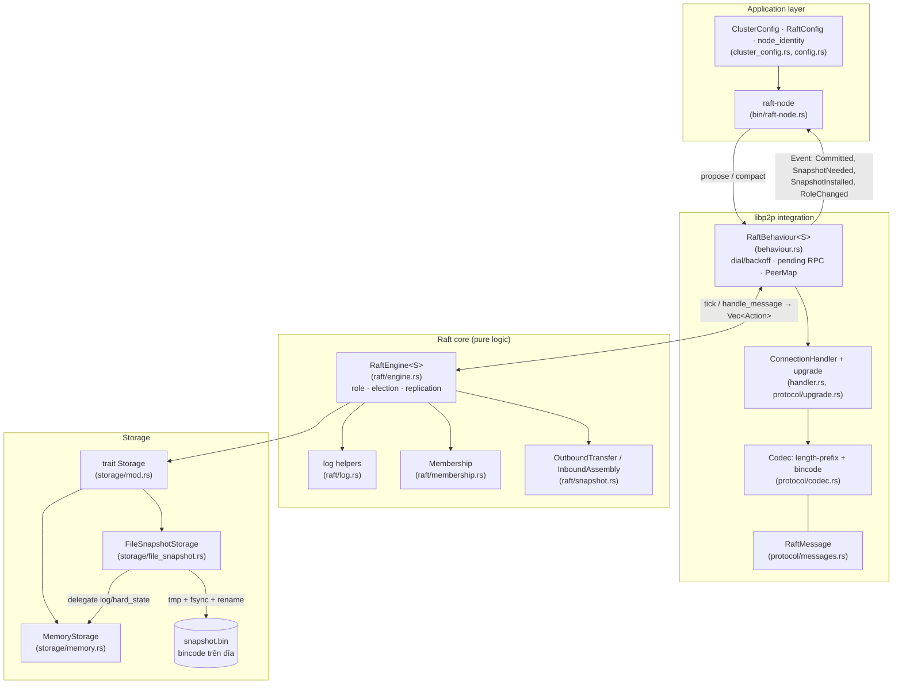
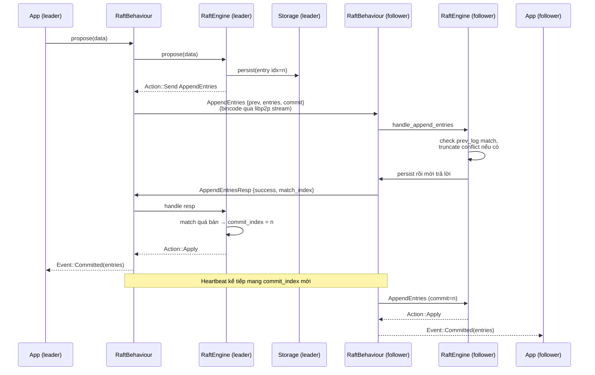
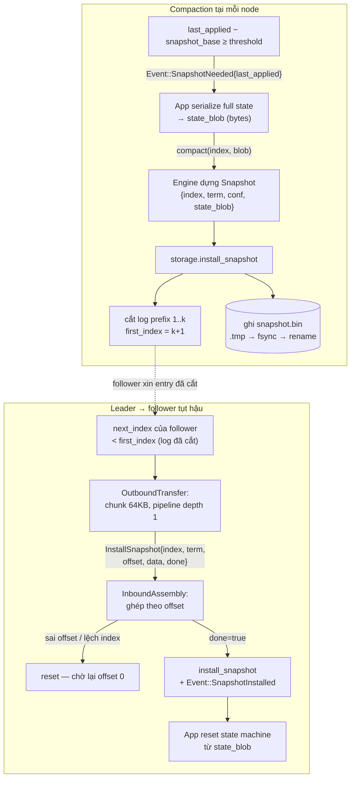

# Sơ đồ kiến trúc & data flow

Ba sơ đồ mermaid tổng hợp: component, luồng replicate một command, và luồng snapshot / compaction. Tên trong ngoặc là file nguồn tương ứng.

## 1. Component

Engine là lõi thuần logic (không async, không IO mạng) — nhận message, trả về danh sách `Action`. Behaviour dịch Action thành RPC libp2p và ngược lại. Storage là trait cắm được: log + hard_state trong RAM, riêng snapshot được `FileSnapshotStorage` ghi đĩa dạng bincode.

## 2. Data flow: Propose → Replicate → Commit

Đường đi của một command từ lúc app đề xuất đến lúc cả cluster apply. Follower ghi log trước khi trả lời (durability barrier); leader chỉ commit khi quá bán số voter đã match.

## 3. Data flow: Snapshot — compact tại chỗ & truyền cho follower tụt hậu

Nhánh trái: node tự compact khi log applied vượt `snapshot_threshold` — app serialize full state thành `state_blob`, log 1..k bị cắt, file `snapshot.bin` được ghi atomic. Nhánh phải: follower cần entry đã bị cắt thì leader stream blob theo chunk 64 KB, hỏng giữa chừng làm lại từ offset 0.

Điểm cần nhớ:

- **Snapshot = state cuối, không phải lịch sử** — blob chỉ chứa trạng thái tại mốc k; snapshot mới ghi đè hoàn toàn snapshot cũ.
- **Stale bị chặn trước khi chạm đĩa** — snapshot có index ≤ snapshot hiện tại bị bỏ qua ở cả RAM lẫn file.
- **Không resume** — transfer đứt giữa chừng thì làm lại từ offset 0 (ràng buộc thiết kế, pipeline depth 1).
